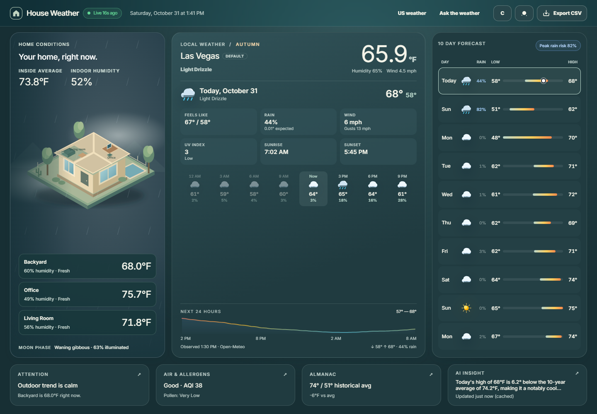
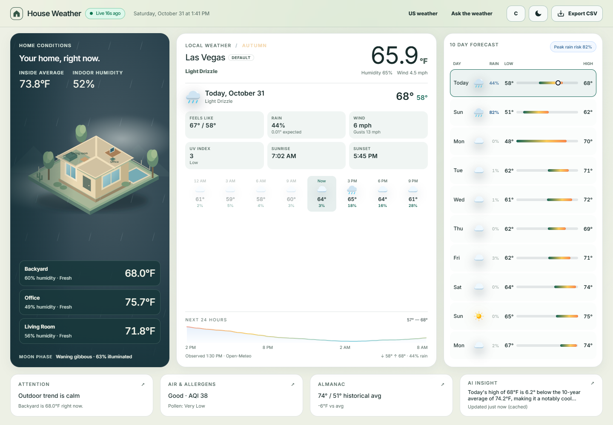
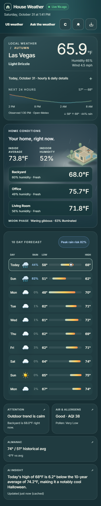

# Govee Dashboard

A local-first dashboard for Govee temperature/humidity sensors with live indoor readings, local weather, active weather alerts, pollen, almanac history, and optional AI-generated insights.

The app is built as a small Flask server plus a static browser UI. It is designed to run well in Docker on a home server, NAS, or desktop.

## Latest release — v2026.11.04

[Download the latest release](https://github.com/tcullum/govee-dashboard/releases/tag/v2026.11.04) · [Release history](https://github.com/tcullum/govee-dashboard/releases)

The November 4, 2026 release improves security, sensor reliability, and efficiency:

- Google sign-in through Cloudflare Access, with signed-token validation at the origin.
- Updated, locked dependencies and a non-root container with read-only application files.
- Shared background sensor polling, bounded AI generation, and persistent pollen/insight request budgets.
- Last valid readings survive upstream failures; freshness indicators continue aging when connectivity stops.
- Location-aware almanac and insights, correct local calendar dates, and a true 24-hour history window.
- Working offline static assets, including the overview interface and versioned scripts.

**Validation:** 81 tests passed (47 backend and 34 browser); the rebuilt environment's 38 Python packages returned zero OSV advisory findings at release validation.

See the [resolution record](docs/dashboard-resolution-2026-11-04.md) for the full changes and verification.

### Upgrading from v2026.10.31

This release changes the supplied production deployment:

1. Pull the latest source and set `CLOUDFLARE_ACCESS_TEAM` and `CLOUDFLARE_ACCESS_AUD` in `.env`.
2. Configure the weather Access application with Google sign-in and an explicit account allow policy. The application must require authentication for all paths.
3. Stop the old container before migrating data. Installations that stored runtime files in the project directory must copy `govee_readings.csv` and desired caches into the `govee_dashboard_data` volume at `/data`. Keep the originals as a backup and give copied files to UID/GID `10001:10001`. Preserve any existing populated volume.
4. Rebuild and start with `docker compose up -d --build`, then open the Cloudflare-protected hostname.

The published port now listens only on `127.0.0.1`. Direct API requests without a valid Access assertion return 401. The existing host cloudflared tunnel can still reach it. `/healthz` remains available for health checks. Future upgrades retain history and request budgets in the data volume.

## Screenshots

Interface screenshots captured October 31, 2026. The November 4 release preserves this layout while improving security and reliability.



<details>
<summary>Light mode and mobile</summary>





</details>

## Features

- Live Govee sensor readings with history sparklines
- Outdoor/local weather from Open-Meteo
- Active weather warnings from the National Weather Service
- Three-day pollen forecasts from Google Maps Platform Pollen API
- 10-day forecast and selectable comparison cities
- Almanac comparison against historical weather
- Optional AI insights and weather questions with OpenRouter or Anthropic Claude
- Desktop overview, tabbed detail views, and a live weather house scene
- Dark/light modes, compact mode, and mobile-friendly layout
- Docker Compose support with isolated persistent storage
- Cloudflare Access protection for the supplied production deployment

## Requirements

- A Govee account with devices supported by the Govee Developer API
- A Govee API key
- Docker and Docker Compose, recommended
- For the supplied production Compose deployment: a Cloudflare Tunnel and an Access application with your Google identity provider configured

Optional:

- OpenRouter or Anthropic API credentials for AI features (the supplied Compose deployment uses OpenRouter)
- Google Maps Platform API key for pollen forecasts

## Quick Start With Docker

1. Clone the repo:

```powershell
git clone https://github.com/tcullum/govee-dashboard.git
cd govee-dashboard
```

2. Create your local environment file:

```powershell
Copy-Item .env.example .env
```

3. Edit `.env`:

```env
GOVEE_API_KEY=your_govee_api_key_here
CLOUDFLARE_ACCESS_TEAM=your-team-name
CLOUDFLARE_ACCESS_AUD=your-weather-application-audience
PORT=8000
ANTHROPIC_API_KEY=
ANTHROPIC_MODEL=claude-haiku-4-5-20251001
GOOGLE_POLLEN_API_KEY=
POLLEN_CACHE_SECONDS=17280
```

`GOVEE_API_KEY` is required for sensor readings. The supplied Compose deployment uses OpenRouter; configure its secret file as described below, or adjust the Compose AI provider/secret settings for your installation. A direct Anthropic key is used only with the Anthropic provider. Configure the Cloudflare Access values before starting the supplied production deployment.

4. Start the dashboard:

```powershell
docker compose up -d --build
```

5. Open your Cloudflare-protected weather hostname. This deployment uses [weather.cullum.dad](https://weather.cullum.dad). Configure its Access application to allow your Google account and remove public bypass policies. The direct localhost port intentionally rejects requests without a signed Access assertion. `/healthz` remains available for container health checks.

## Running Without Docker

```powershell
python -m venv venv
.\venv\Scripts\Activate.ps1
pip install -r requirements.txt
Copy-Item .env.example .env
python govee_server.py
```

Then open [http://localhost:8000](http://localhost:8000).

On macOS/Linux, activate the virtual environment with:

```bash
source venv/bin/activate
```

## OpenRouter deployment

This deployment uses `AI_PROVIDER=openrouter` for both Ask the weather and AI Insights, with `OPENROUTER_MODEL=anthropic/claude-sonnet-4.6`. Billing is through OpenRouter, not the direct Anthropic account.

Docker mounts the supplied `govee.env` as a read-only Compose secret at `/run/secrets/openrouter_key`; `OPENROUTER_API_KEY_FILE` points to it. The file can contain a bare key or an `OPENROUTER_API_KEY=...` assignment. Do not delete or move the source file without updating the Compose secret path. The credential is not copied into the repository or image and is not sent to the browser. Alternatively, server deployments may supply `OPENROUTER_API_KEY` directly.

OpenRouter requests use a fixed HTTPS endpoint, disabled redirects, no automatic retries, a five-second connect / forty-second read timeout, and bounded output. Only complete text responses are accepted. The origin checks and question rate limit remain enabled. Forecast questions and insights context are sent to OpenRouter and the selected model provider.

Offline tests (the override exercises retained Anthropic compatibility alongside explicit OpenRouter tests; it does not change the running service):

```sh
docker run --rm -e AI_PROVIDER=anthropic -e GOVEE_DATA_DIR=/tmp/dashboard-tests --mount type=bind,source=C:\govee-dashboard,target=/app,readonly govee-dashboard:review-fixes python -m unittest test_security_resilience test_sensor_readings test_openrouter_ai test_weather_questions test_pollen_api -q
```

## Environment Variables

| Variable | Required | Description |
| --- | --- | --- |
| `CLOUDFLARE_ACCESS_TEAM` | Docker | Cloudflare Access team subdomain, without `.cloudflareaccess.com`. |
| `CLOUDFLARE_ACCESS_AUD` | Docker | Audience tag of this weather application. |
| `HOME_LATITUDE`, `HOME_LONGITUDE` | No | Default home forecast coordinates. |
| `HOME_TIMEZONE` | No | Home IANA timezone; defaults to `America/Los_Angeles`. |
| `HOME_NAME` | No | Home location label; defaults to `Las Vegas`. |
| `GOVEE_TEMPERATURE_UNIT` | No | Router API temperature units for this account: `F` (default) or `C`. |
| `GOVEE_DATA_DIR` | No | Runtime storage directory (`/data` in Docker). |
| `GOVEE_API_KEY` | Yes | Govee Developer API key used to read sensor data. |
| `PORT` | No | Server port. Defaults to `8000`. |
| `AI_PROVIDER` | No | AI provider: `anthropic` (server default) or `openrouter` (supplied Compose deployment). |
| `OPENROUTER_API_KEY` | No | Server-only OpenRouter key; alternatively use `OPENROUTER_API_KEY_FILE`. |
| `OPENROUTER_API_KEY_FILE` | No | Path to a file containing the OpenRouter key. |
| `OPENROUTER_MODEL` | No | Model used through OpenRouter. |
| `ANTHROPIC_API_KEY` | No | Enables AI features with the Anthropic provider. |
| `ANTHROPIC_MODEL` | No | Anthropic model used for AI insights. |
| `GOOGLE_POLLEN_API_KEY` | No | Server-only Google Maps Platform key with the Pollen API enabled. |
| `POLLEN_CACHE_SECONDS` | No | In-memory pollen reuse window. Defaults to `17280` (4 hours 48 minutes, about five upstream calls daily). |
| `LOG_RETENTION_DAYS` | No | Days of sensor history kept in `govee_readings.csv`. Defaults to `30`. |
| `GOVEE_DEVICE_CACHE_SECONDS` | No | How long the stable Govee device inventory is cached. Defaults to `1800` (30 minutes). |
| `NOAA_TOKEN` | No | Reserved for future/legacy NOAA use. Current weather alerts use public NWS endpoints. |

## Getting A Govee API Key

1. Open the Govee app.
2. Go to account/settings.
3. Find the developer/API key section.
4. Request or copy your API key.
5. Paste it into `.env` as `GOVEE_API_KEY`.

Do not commit `.env`. It is intentionally ignored by Git.

## Useful Commands

Start or rebuild:

```powershell
docker compose up -d --build
```

View logs:

```powershell
docker compose logs --tail=120
```

Stop:

```powershell
docker compose down
```

Check server health/status:

[http://localhost:8000/api/status](http://localhost:8000/api/status)

Request a shared readings refresh (all triggers share a 45-second minimum interval):

[http://localhost:8000/api/readings?refresh=1](http://localhost:8000/api/readings?refresh=1)

## Data And Caches

Production stores runtime files in the `govee_dashboard_data` Docker volume mounted at `/data`. Source files are read-only in the image. Local development defaults to the project directory; set `GOVEE_DATA_DIR` to use a separate data directory. Runtime files include:

- `govee_readings.csv` for sensor history (automatically trimmed to the last `LOG_RETENTION_DAYS` days, 30 by default)
- `almanac_cache.json` for historical weather cache
- `insights_cache.json` for AI insight cache
- `pollen_budget.json` and `insights_budget.json` for durable upstream-attempt limits

These are ignored by Git so each user keeps their own local data. Sensor history is served from an in-memory cache, so the CSV is only read once at startup. Use the export button in the dashboard header (or `/api/export`) to download the full CSV.

## Customizing The Dashboard

Common places to customize:

- City comparison list: `LOCATION_PRESETS` in `app.js`
- Default comparison cities: `DEFAULT_LOCATION_IDS` in `app.js`
- Outdoor sensor detection: `OUTDOOR_KEYWORDS` in `app.js`
- Home weather defaults: `HOME_LATITUDE`, `HOME_LONGITUDE`, `HOME_TIMEZONE`, and `HOME_NAME` in `.env`
- Visual styling and weather scene animation: `style.css`

The local weather panel asks the browser for geolocation when available. If geolocation is blocked or unavailable, it uses the configured home location (Las Vegas by default).

The house scene follows current weather conditions and local solar time, refreshed each minute. The permanent house cutaway shows live room and backyard readings in anchored markers. Moon phase and illumination remain visible even when the moon is below the horizon.

## API Endpoints

| Endpoint | Purpose |
| --- | --- |
| `/api/readings` | Current Govee readings, cached briefly for fast UI refresh. |
| `/api/readings?refresh=1` | Request a refresh through the shared polling guard. |
| `/api/history` | 24 hours of per-device history, downsampled, served from memory. |
| `/api/export` | Download the full readings CSV. |
| `/api/almanac` | Historical weather averages from Open-Meteo Archive. |
| `/api/pollen?lat=...&lon=...` | Server-side Google pollen forecast proxy with bounded caching and rate limiting. |
| `/api/almanac/insights` | GET cached/pending insights; POST requests a bounded refresh. Uses the configured AI provider. |
| `/api/config` | Configured home coordinates, timezone and label. |
| `/healthz` | Minimal unauthenticated container health check. |
| `/api/status` | Cache, refresh, history retention, and AI status. |

## Ask The Weather API

Weather questions use the same AI provider configuration as AI Insights: OpenRouter in the supplied deployment, or `ANTHROPIC_API_KEY` and `ANTHROPIC_MODEL` with the Anthropic provider. No extra key is needed. Each question is standalone; there is no conversation history or answer cache.

`GET /api/weather/ask/status` returns `{"available": true}` when a nonblank server key is configured. This is a configuration check, **not** a successful provider/billing/model health check, and makes no paid call.

`POST /api/weather/ask` requires `Content-Type: application/json` and exactly these fields:

```json
{
  "question": "Will I need an umbrella tomorrow afternoon?",
  "latitude": 36.17,
  "longitude": -115.14,
  "unit": "F",
  "location": "Las Vegas"
}
```

- `question`: nonblank string, at most 1,000 characters.
- `location`: nonblank display label, at most 120 characters; coordinates, not this unverified label, determine the forecast.
- `latitude` / `longitude`: finite JSON numbers in [-90, 90] / [-180, 180]; booleans and numeric strings are rejected.
- `unit`: exactly `F` or `C`. Fahrenheit uses mph/inches; Celsius uses km/h/mm. Other field units remain explicitly identified in forecast metadata.
- Maximum body: 8,192 bytes. Extra fields, client forecasts and custom upstream URLs are rejected.

Success is `{"answer": "...", "sources": [{"label": "Open-Meteo forecast", "url": "https://open-meteo.com/"}], "generated_at": "<UTC ISO timestamp>", "location": "Las Vegas", "unit": "F"}`. Render the answer as text, not HTML. Responses use `Cache-Control: no-store`.

The server fetches fresh Open-Meteo current conditions, the next 48 hourly forecast entries and seven daily forecasts over HTTPS, with no redirects. It includes timestamps, local timezone, retrieval time and unit metadata in the model context; current timestamps older than two hours or over 15 minutes in the future are rejected. The prompt requires admitting missing data, uncertainty and questions beyond the forecast horizon. It does not include sensor secrets, pollen, historical records or official severe-weather alerts. AI answers are not safety guarantees; consult official alerts for hazardous weather. No tools, device control or other actions are available to the model. The question and supplied location are sent to Anthropic; coordinates are sent to both forecast and AI providers.

Cost and availability safeguards:

- One in-flight question and at most **10 admitted attempts per rolling hour**, shared across all clients of the running Flask app. Upstream failures count; invalid requests and busy rejections do not. The in-memory budget resets on restart. This is a single-process limit: do not add multiple WSGI workers/replicas without a shared limiter or equivalent proxy controls.
- At most one forecast request and one AI generation per admitted attempt, with no retries. Network timeouts are 12 seconds for the forecast and 30 seconds for Anthropic; these are network-operation timeouts, not a hard end-to-end deadline. Output is capped at 800 tokens; serialized forecast context at 40,000 characters. Empty, truncated and non-text model responses are errors, never fallback answers.
- Cross-origin browser paid requests are rejected using Origin/Referer and Fetch Metadata checks; no CORS access is granted. Same-origin LAN URLs work, including plain HTTP LAN use. For the Cloudflare deployment, `WEATHER_PUBLIC_ORIGIN=https://weather.cullum.dad` permits the configured HTTPS public origin while the Flask origin remains HTTP behind the proxy. JSON API clients without browser origin headers are permitted. This is not authentication: keep the dashboard on a trusted LAN/VPN, and add authentication plus host validation at a reverse proxy before exposing it publicly. Never trust arbitrary client-supplied forwarded host/scheme headers.

Errors are JSON `{"error": "Readable safe message"}`: 400 invalid input, 403 cross-origin, 413 oversized body, 415 wrong content type, 429 local busy/hourly limit (with `Retry-After`), 502 unusable forecast or failed AI generation, 503 missing/rejected AI credentials or provider rate limit, and 504 upstream timeout. Provider exception bodies and keys are never returned by these endpoints. A configured key can still fail because of billing, model access or provider availability.

Run the isolated mocked-upstream regression suite:

```powershell
docker exec govee-dashboard python -m unittest test_weather_questions -v
```

## Troubleshooting

If no sensors appear:

- Confirm `GOVEE_API_KEY` is set in `.env`.
- Run `docker compose logs --tail=120`.
- Open `/api/readings?refresh=1` and check for returned errors.
- Confirm your devices are visible to the Govee Developer API.

If AI insights fail:

- Set `ANTHROPIC_API_KEY`.
- Confirm `ANTHROPIC_MODEL` is available for your Anthropic account.
- Check `/api/status` and Docker logs.

If weather warnings look wrong:

- Allow browser location access, or update the fallback coordinates in `app.js`.
- Weather alerts are provided by the National Weather Service and are US-focused.

## Security Notes

- Keep `.env` private.
- Restrict `GOOGLE_POLLEN_API_KEY` to the Pollen API and, where practical, to the server's outbound IP.
- The server only serves an explicit allowlist of static files; `.env`, the readings CSV, caches, and server source are never reachable over HTTP.
- Do not expose the dashboard publicly unless you understand the risks.
- If you publish it through a tunnel or reverse proxy, consider adding authentication at the proxy layer.

## License

MIT License. See [LICENSE](LICENSE).

## Security and refresh behavior

The supplied Compose deployment requires Cloudflare Access, validates RS256 assertions at the origin (issuer, audience, signature, expiry and user identity), and publishes only on `127.0.0.1`. Cloudflared must run on the host or another explicitly configured private connection. Ordinary local development binds to loopback and does not require Access unless `CLOUDFLARE_ACCESS_REQUIRED=true` is set. Do not expose that development configuration publicly.

AI insights run in the background. GET returns cached or pending results; POST requests a refresh. All generation attempts, including failures, share a durable four-attempt daily cap and 15-minute minimum interval. Only one insight operation runs at a time. Sensor refreshes also share one background operation. The pollen budget counts every outbound attempt, persists across restarts, and never holds the cache lock during network I/O.

Almanac and insights requests accept `lat`, `lon`, and `timezone`; the browser sends its forecast location. Caches are keyed by location and local calendar date. Insight timestamps include a timezone offset. Old sensor values remain visible during outages but are excluded from fresh AI context; `/api/history` returns only the last 24 hours.

Dependencies are pinned in `requirements.txt` and the complete resolved Linux environment in `requirements.lock`. Rebuild to apply dependency updates; restarting does not change installed packages. The image copies explicit application assets, runs as UID 10001, and uses a read-only root filesystem with a dedicated writable data volume.

Browser tests support `DASHBOARD_TEST_URL` for an isolated local preview. See [the resolution record](docs/dashboard-resolution-2026-11-04.md) for the audit-to-fix mapping and validation results.
